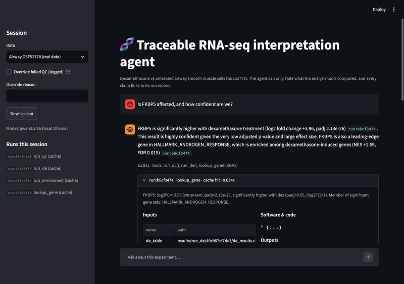
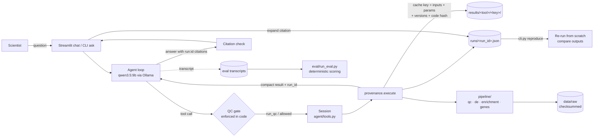
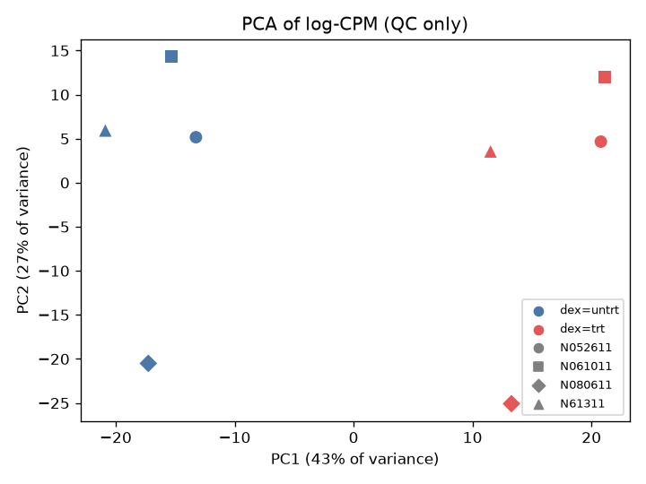
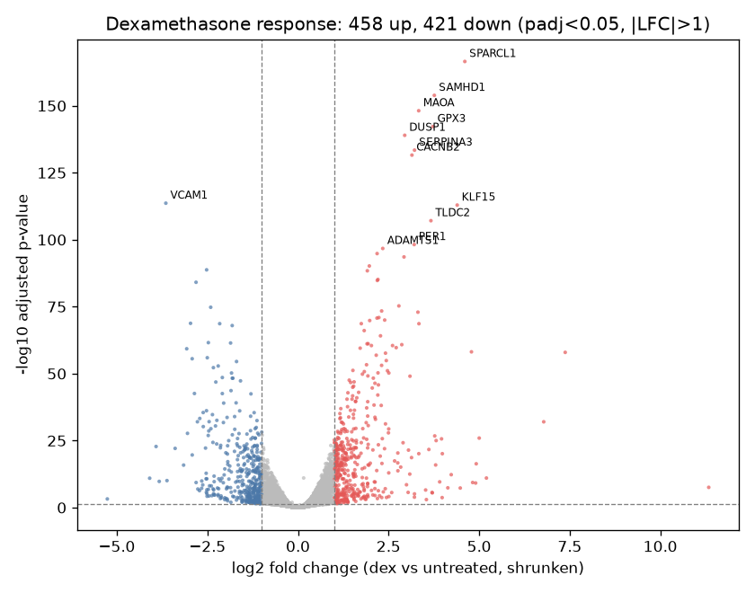
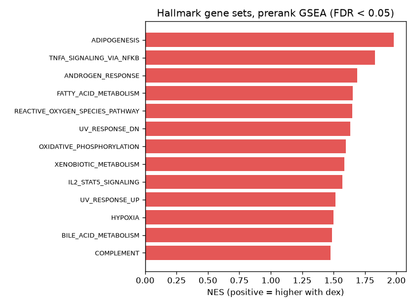

# Traceable RNA-seq interpretation agent

**An agent that can't claim anything it didn't compute, and can prove where every claim came from.**

Ask a plain-English question about an RNA-seq experiment ("Is FKBP5 affected, and how confident are we?"). A local LLM answers only by calling real analysis tools: QC, differential expression, pathway enrichment, and gene lookup. Every factual sentence cites the run record that produced it, any run can be re-executed and verified, a QC gate blocks interpretation of bad data, and an evaluation harness measures hallucinations with deterministic code.



## The problem

Sequencing is cheap; interpretation is the bottleneck. A scientist with a count matrix wants answers ("which pathways respond to this drug?"), but turning a DESeq2 table into a trustworthy answer takes an analyst. LLMs can talk about biology fluently, which is the danger: they will happily state fold changes and pathways that were never computed. For decisions, every number has to be traceable to the analysis that produced it, and that analysis has to be reproducible.

This project is a small, honest version of that idea on one public dataset.

## What it does

| | |
|---|---|
| **Dataset** | Human airway smooth muscle cells, 4 donors × {untreated, dexamethasone}: 8 samples ([GSE52778](https://www.ncbi.nlm.nih.gov/geo/query/acc.cgi?acc=GSE52778), Himes et al. 2014). NCBI-reprocessed raw counts. |
| **Tools** | `run_qc` (gate), `run_de` (PyDESeq2, `~cell + dex`), `run_enrichment` (prerank GSEA, MSigDB Hallmark), `lookup_gene` |
| **Agent** | `qwen3.5:9b` running locally in Ollama, with tool calling. No API key, no data leaves the laptop. |
| **Provenance** | Every tool call writes `runs/<run_id>.json` (input checksums, parameters, versions, code hash, git commit, output checksums). Answers cite `[run:id]`. `reproduce <run_id>` re-runs and verifies. |
| **Guardrails in code** | Expression tools refuse to run until QC passes; only the human can override (logged). Citations to run ids not in the session are flagged. |
| **Evaluation** | 15 questions; deterministic checks for gene agreement, hallucinated genes/pathways/numbers, citation coverage and support, refusals, and the QC gate. |

## Architecture



## Setup and run

Requirements: Python 3.11+ (developed on 3.13), [Ollama](https://ollama.com) with `qwen3.5:9b` pulled (`ollama pull qwen3.5:9b`). Raw data is committed (7.6 MB, checksummed), so nothing needs downloading.

```bash
python3 -m venv .venv && .venv/bin/pip install -r requirements.txt
cp .env.example .env                                   # defaults: local Ollama, qwen3.5:9b

.venv/bin/python cli.py analyze                        # QC gate -> DE -> GSEA, with run records
.venv/bin/python cli.py ask "Is FKBP5 affected, and how confident are we?"
.venv/bin/python cli.py lookup NR3C1                   # one gene, no LLM
.venv/bin/python cli.py runs                           # list run records
.venv/bin/python cli.py reproduce <run_id>             # re-execute and verify
.venv/bin/streamlit run ui/app.py                      # chat UI with provenance panels
.venv/bin/python -m eval.run_eval                      # re-score saved transcripts (no LLM)
.venv/bin/python -m eval.run_eval --live               # ask the model again (~12 min)
.venv/bin/python -m pytest -q                          # 83 tests
```

`notebooks/01_walkthrough.ipynb` runs the full analysis without the agent, for checking the science. `DEMO.md` is a 2-minute demo script.

## Analysis methods

| Step | Method and parameters |
|---|---|
| Data | NCBI-generated raw counts on GRCh38.p13 (39,376 NCBI GeneIDs × 16 samples); keep the 8 untreated/dex samples. GeneID → symbol from NCBI `gene_info`, with retired IDs mapped through `gene_history` (100% mapped; see `data/SOURCES.md`). |
| Low-count filter | Keep genes with ≥ 10 reads in ≥ 4 samples (smallest group size) → 16,802 genes. |
| QC gate | Library size ≥ 50% of median; no sample > 3 robust SD (1.4826 × MAD) from its treatment group's PC1/PC2 centroid (log-CPM, top 500 variable genes); every sample's best-matching other sample correlates at r ≥ 0.90. Reports which factor drives PC1/PC2 (one-way ANOVA R²). |
| Differential expression | PyDESeq2 0.5.4, design `~ cell + dex` (donor as blocking factor), reference level `untrt` set explicitly, Wald test, Benjamini–Hochberg, Cook's outlier refit, apeGLM-style LFC shrinkage on `dex[T.trt]`. Significant = padj < 0.05 and \|shrunken log2FC\| > 1. |
| Enrichment | gseapy 1.3.1 prerank GSEA on the Wald statistic; MSigDB Hallmark v2026.2 (local GMT, checksummed); set size 15–500; 1,000 permutations; seed 42; FDR < 0.05. One row per symbol (prefer current GeneID, then highest baseMean); ties broken by symbol for determinism. |
| Determinism | Fixed seeds; DE and GSEA outputs reproduce byte-for-byte (`reproduce`). |

### Key results (no LLM involved)

* **QC passes.** PC1 (43% of variance) is treatment, R²(dex) = 0.95; PC2 (27%) is donor, R²(cell) = 0.99.
* **879 genes significant: 458 up, 421 down.** Top hits include SPARCL1, SAMHD1, MAOA, GPX3, DUSP1 (up) and VCAM1 (down). The six genes with the smallest p-values in the Bioconductor DESeq2 airway workflow [2] (MAOA, DUSP1, SAMHD1, SPARCL1, SERPINA3, GPX3) are the same six as ours, in a slightly different order, with log2 fold changes within ~0.12, even though that workflow quantifies the reads differently (Salmon/GENCODE).
* **Paired design matters:** ignoring donor (`~dex`) finds 689 significant genes instead of 879.
* **13 Hallmark sets enriched among dex-induced genes, none among repressed** (top: adipogenesis, TNFα signaling via NF-κB, androgen response). The NF-κB set's leading edge is DUSP1, PER1, KLF9: DUSP1 and PER1 are named as well-known glucocorticoid-responsive genes in this dataset's own paper [1], and KLF9 is a glucocorticoid-induced gene with glucocorticoid-receptor binding sites upstream of it in lung epithelial cells [4] (also shown in liver [5]). A plausible reading is that glucocorticoid targets that happen to sit in the set drive its positive score, rather than NF-κB signaling being activated. That's an interpretation, not something computed here, and a reminder to read leading edges, not just pathway names.
* **Agreement with the authors' own analysis** (their Cuffdiff table on GEO, an independent and unpaired pipeline): log2 fold changes correlate at Spearman 0.959, and all 280 genes significant in both pipelines change in the same direction.

| QC: PCA | Differential expression | Pathways |
|---|---|---|
|  |  |  |

## Provenance design

Every tool runs through `pipeline/provenance.execute()`, which:

1. **Checksums every input** (SHA-256). Raw files are also checked against `config.EXPECTED_SHA256` on load.
2. **Builds a cache key** = SHA-256 of (tool, input checksums, parameters, package versions, the tool's own source code). Same key → stored result returned and recorded as a cache hit. Editing a tool's code invalidates its cache automatically.
3. **Computes into a content-addressed folder** `results/<tool>/<key[:12]>/`.
4. **Writes a run record** `runs/<run_id>.json`:

```json
{
  "run_id": "fd6b20f5", "tool": "run_enrichment", "timestamp_utc": "2026-10-21T15:26:41+00:00",
  "inputs": {"de_table": {"path": "results/run_de/58abd16105cd/de_results.csv", "sha256": "3d6ca5c4…"},
             "gene_sets": {"path": "data/raw/h.all.v2026.2.Hs.symbols.gmt", "sha256": "56bba130…"}},
  "parameters": {"method": "prerank GSEA", "permutation_num": 1000, "seed": 42, "fdr_threshold": 0.05, "…": "…"},
  "software": {"python": "3.13.7", "pydeseq2": "0.5.4", "gseapy": "1.3.1", "pandas": "3.0.6", "…": "…"},
  "code_sha256": "ce993e9b…", "git": {"commit": "da769fb…", "pipeline_dirty": true},
  "outputs": {"table": "results/run_enrichment/2c9e6a2a646b/gsea_results.csv", "plot": "…"},
  "output_sha256": {"table": "14c47ac8…", "plot": "412a3bbc…"},
  "upstream_runs": ["4e9e94fb"], "cache_hit": true, "duration_s": 0.024
}
```

`cli.py reproduce <run_id>` refuses to proceed if any input checksum changed, warns on version or code drift, re-executes from scratch (never from cache), and compares outputs: tables and JSON numerically (rtol 1e-6), plots by checksum. A user overriding a failed QC gate is logged as its own record.

**Agent rules** (`agent/system_prompt.md`): QC first; never state a gene, pathway, or number not in a tool result from this session; cite a run id for every finding; put general knowledge only in a final paragraph labelled "Context (not computed here)"; say "not tested" or "I don't know" when appropriate.

## Evaluation

`eval/run_eval.py` scores saved transcripts with deterministic code; no LLM grades another LLM. Expected values are read from the pipeline's own run outputs, not hard-coded. Full report: [`eval/report.md`](eval/report.md); every change made after looking at results: [`eval/CHANGELOG.md`](eval/CHANGELOG.md).

| Metric (15 questions, qwen3.5:9b, temperature 0) | v1 baseline | **v2** |
|---|---|---|
| Questions fully passed | 7/15 | **14/15** |
| Agreement with literature genes (significant, right direction) | 2/7 | **7/7** |
| Unsupported claims / all claims (hallucination rate) | 0/76 | 2/120 |
| Citation support (cited claims found in the cited run) | 23/23 | **29/29** |
| Fabricated run ids | 0 | 0 |
| Refusal / QC-gate checks (unknown gene, untested gene, failed QC) | 3/5 | **5/5** |
| Citation coverage (strict per-sentence) | 92% (52%) | 85% (56%) |
| Mean latency | 60 s | 44 s |

**What changed between v1 and v2:** with thinking mode on, the local model sometimes put its whole answer in the hidden *thinking* channel and returned an empty reply (7/15 in v1). The fix is one retry asking for the answer; thinking text is never shown to the user. The system prompt was not changed. One scorer bug (q05) was fixed and its effect measured on its own (v1 re-scored: 8/15).

**Remaining issues, documented rather than tuned away:**
* For an unknown gene, the agent suggested "BRCA1 or BRCA2" without looking them up (2 unsupported claims).
* Some restating sentences go uncited (strict coverage 56%), although every cited sentence checked out.
* The QC-blocked answer doesn't cite the QC run and says "please confirm if you want to proceed". The gate is enforced in code, so chat can't override it, but the wording is misleading, and the scorer misses it because the answer has no gene or number.

`eval/expected.yaml` is a sanity check, not ground truth. Every gene has a source: FKBP5, TSC22D3, PER1, KLF15, DUSP1 and CRISPLD2 are named in this dataset's own paper [1], and ZBTB16 is a top glucocorticoid-induced gene in an independent airway smooth muscle study [3].

## Limitations

* **One small dataset, one contrast.** 8 samples from 4 donors; dex vs untreated only. Results say nothing about other cell types, doses, or time points.
* **Gene-set choice.** Hallmark's 50 broad sets make results readable but coarse; the NF-κB example shows set names can mislead. Reactome or GO would give different, more specific answers.
* **Annotation.** NCBI GeneIDs from GRCh38.p13 mapped to today's symbols; ~320 symbols have more than one GeneID row, collapsed by a documented rule.
* **LLM variability.** One eval run of 15 questions at temperature 0. Answers can change between runs or model versions, and a 9B local model is weaker than frontier models. Latency is 20–70 s per answer on a laptop.
* **Eval blind spots.** Plain-English pathway names, spelled-out numbers, and wrong relationships between correct facts (beyond the one ranking check) are not detected. Direction claims are read with keyword rules.
* **QC thresholds** were set on this dataset (the correlation rule was calibrated against a deliberately scrambled sample), not validated across studies.
* **Not validated for clinical or diagnostic use.**
* Literature support for the expected genes and for the NF-κB interpretation comes from a handful of papers (see References), not a systematic review.
* MSigDB Hallmark gene sets are redistributed under MSigDB's license terms (checked by the repository owner, 2026-10-21; see [terms](https://www.gsea-msigdb.org/gsea/msigdb_license_terms.jsp)). Hallmark collection: Liberzon et al., *Cell Systems* 2015.

## What I'd do next

* **Multiple datasets and contrasts:** a dataset registry so the agent can compare studies (e.g. dex in airway vs other tissues), with provenance per dataset.
* **Batch correction:** detect and model batch or known covariates (and show the agent when a covariate dominates a PC), instead of a single fixed design.
* **Single-cell support:** pseudobulk per cell type through the same DE and provenance path, so claims cite cell-type-specific runs.
* **A knowledge layer with citations to papers:** retrieval over literature so "Context" paragraphs become cited claims too ("FKBP5 is a known GR target [PMID:…]") instead of uncited general knowledge, held to the same grounding checks.
* **Comparison against a human analyst:** give a computational biologist the same questions and data, and score both reports on accuracy, coverage, and time.
* **Close the known gaps:** cite the QC run in blocked answers, forbid unrequested gene suggestions, and add a scorer check for QC-answer citations, each logged in the changelog with a before/after run.

## References

1. Himes BE, Jiang X, Wagner P, et al. RNA-Seq transcriptome profiling identifies CRISPLD2 as a glucocorticoid responsive gene that modulates cytokine function in airway smooth muscle cells. *PLoS One* 2014;9(6):e99625. [PMID 24926665](https://pubmed.ncbi.nlm.nih.gov/24926665/) · doi:10.1371/journal.pone.0099625. The source of the data. 316 DE genes, with DUSP1, KLF15, PER1, TSC22D3 named as well-known glucocorticoid-responsive genes and FKBP5 validated by qRT-PCR.
2. Love MI, Anders S, Kim V, Huber W. *RNA-seq workflow: gene-level exploratory analysis and differential expression* (Bioconductor `rnaseqGene` workflow, Bioconductor 3.23). [bioconductor.org/…/rnaseqGene.html](https://bioconductor.org/packages/release/workflows/vignettes/rnaseqGene/inst/doc/rnaseqGene.html). Same design (`~ cell + dex`) and the same low-count filter rule as here.
3. Kan M, Koziol-White C, Shumyatcher M, et al. Airway smooth muscle-specific transcriptomic signatures of glucocorticoid exposure. *Am J Respir Cell Mol Biol* 2019. [PMID 30694689](https://pubmed.ncbi.nlm.nih.gov/30694689/) · doi:10.1165/rcmb.2018-0385OC. Budesonide in ASM. ZBTB16 log2FC 6.75 among the top genes.
4. Mostafa MM, Bansal A, Michi AN, et al. Genomic determinants implicated in the glucocorticoid-mediated induction of KLF9 in pulmonary epithelial cells. *J Biol Chem* 2021. [PMID 33184061](https://pubmed.ncbi.nlm.nih.gov/33184061/) · doi:10.1074/jbc.RA120.015755.
5. Cui A, Fan H, Zhang Y, et al. Dexamethasone-induced Krüppel-like factor 9 expression promotes hepatic gluconeogenesis and hyperglycemia. *J Clin Invest* 2019. [PMID 31033478](https://pubmed.ncbi.nlm.nih.gov/31033478/) · doi:10.1172/JCI66062.
6. Galuh S, Faught E, Klaassen I, et al. The glucocorticoid receptor is affected by its target ZBTB16 in a dissociated manner. *J Endocrinol* 2025. [PMID 40540650](https://pubmed.ncbi.nlm.nih.gov/40540650/) · doi:10.1530/JOE-24-0283.
7. Liberzon A, Birger C, Thorvaldsdóttir H, et al. The Molecular Signatures Database (MSigDB) hallmark gene set collection. *Cell Systems* 2015.

## Repository layout

```
pipeline/   config, data (load + checksums + gene map), qc, de, enrichment, genes, provenance, cache
agent/      tools.py (Session), agent.py (Ollama loop, QC gate, citation check), system_prompt.md
eval/       questions.yaml, expected.yaml, hallucination.py, run_eval.py, report.md, CHANGELOG.md, transcripts/
ui/app.py   Streamlit chat with expandable provenance panels
cli.py      analyze | ask | lookup | runs | reproduce
notebooks/  01_walkthrough.ipynb (built by build_walkthrough.py)
data/       raw/ (committed, checksummed), SOURCES.md
tests/      83 tests (QC gate, DE, provenance, cache keys, reproduce, agent loop, hallucination extractor)
```
